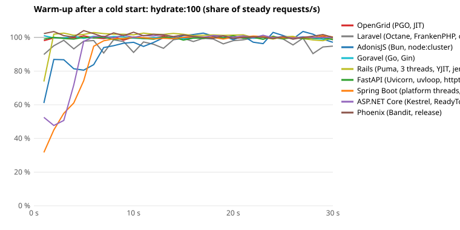

PHP: 8.5.11 built into FrankenPHP (Laravel's only target since 28.10.); php 8.4.21 for artisan.

Median of 3 runs of the same binaries; the range of requests per second over the runs in square brackets. Non-2xx responses are summed over the runs.

**Disturbances** — recorded during the measurement and shown with the results.

- Non-2xx responses, OpenGrid: 8 of 34 420 107 (opengrid-embedded-core create at 16 connections: 2; opengrid-embedded-core create at 64 connections: 4; opengrid-embedded-pgo-core create at 16 connections: 1; opengrid-embedded-pgo-core create at 64 connections: 1) — accepted: SQLite's write lock was not free within busy_timeout (5 s) under sustained writes.
- Non-2xx responses, Laravel: 0 of 1 423 719.
- Non-2xx responses, AdonisJS: 0 of 7 258 538.
- Non-2xx responses, Goravel: 7 of 13 081 871 (goravel-core create at 16 connections: 3; goravel-core create at 64 connections: 4) — accepted: SQLite's write lock was not free within busy_timeout (5 s) under sustained writes.
- Non-2xx responses, Rails: 0 of 2 806 116.
- Non-2xx responses, FastAPI: 0 of 5 100 158.
- Non-2xx responses, Spring Boot: 1 of 14 229 217 (spring-platform-core create at 16 connections: 1) — accepted: SQLite's write lock was not free within busy_timeout (5 s) under sustained writes.
- Non-2xx responses, ASP.NET Core: 2 of 29 114 181 (dotnet-core create at 16 connections: 1; dotnet-core create at 64 connections: 1) — accepted: SQLite's write lock was not free within busy_timeout (5 s) under sustained writes.
- Non-2xx responses, Phoenix: 0 of 6 333 547.
- Run 1: quiet check 20860 findings; load generator above 90 % busy at 0 points; no tool warnings.
- Run 2: quiet check 20575 findings; load generator above 90 % busy at 0 points; no tool warnings.
- Run 3: quiet check 20197 findings; load generator above 90 % busy at 0 points; no tool warnings.
- Findings on idle cores without a thread inside the container come from outside it (host kernel threads or host processes, not visible in the container's PID namespace).
- SurrealDB is not measured; the OpenGrid targets still open their embedded SurrealDB at start (job poller), with no queries per request: it is part of OpenGrid's start time and memory.

Requests per second at 16 connections (p99 in brackets).

**(a) Framework core: raw SQL on SQLite** — both frameworks run exactly the same SQL statements against the same SQLite database in their own process (same library, WAL, synchronous FULL); ORM and auth are replaced by these statements on both sides on purpose

| Endpoint | OpenGrid (PGO) | without PGO | Laravel Octane (FrankenPHP) | OpenGrid / best Octane | OpenGrid / best other framework |
|---|---:|---:|---:|---:|---:|
| health | 138 023 [123 538–140 418] (p99 0.3 ms) | 137 274 [123 485–137 478] (p99 0.3 ms) | 7 549 [7 399–7 673] (p99 4.6 ms) | 18.3× | 0.50× (ASP.NET Core) |
| list | 38 640 [38 528–38 840] (p99 1.0 ms) | 37 743 [37 618–37 966] (p99 1.0 ms) | 5 137 [4 891–5 154] (p99 6.4 ms) | 7.5× | 1.05× (ASP.NET Core) |
| show | 67 814 [67 770–69 189] (p99 0.5 ms) | 66 354 [66 055–66 795] (p99 0.5 ms) | 6 053 [6 009–6 174] (p99 5.6 ms) | 11.2× | 0.73× (ASP.NET Core) |
| create | 1 347 [1 343–1 375] (p99 13.0 ms) | 1 350 [1 332–1 351] (p99 13.4 ms) | 849 [848–851] (p99 69.0 ms) | 1.6× | 1.05× (Goravel) |
| login | 82 [82–82] (p99 235.7 ms) | 87 [87–87] (p99 241.8 ms) | 94 [94–94] (p99 211.0 ms) | 0.9× | 0.85× (Rails) |

**(a') All frameworks per endpoint** (BENCH3) — raw SQL on SQLite as (a), 16 connections; per framework its fastest server variant over all endpoints (Laravel: the faster Octane server); rank by requests per second; *OpenGrid / it* is OpenGrid (PGO, JIT) against that framework. Spring Boot is the upper reference for a mature JIT (the JVM).

*health*

| Rank | Framework (variant) | requests/s | p99 ms | OpenGrid / it |
|---:|---|---:|---:|---:|
| 1 | ASP.NET Core (Kestrel, ReadyToRun) | 277 815 [275 718–283 205] | 0.3 | 0.50× |
| 2 | Spring Boot (platform threads, AOT cache) — JIT reference | 144 236 [142 949–144 564] | 0.2 | 0.96× |
| 3 | OpenGrid (PGO, JIT) | 138 023 [123 538–140 418] | 0.3 | – |
| 4 | Goravel (Go, Gin) | 128 578 [128 540–129 375] | 0.9 | 1.07× |
| 5 | Phoenix (Bandit, release) | 74 262 [71 850–74 314] | 0.4 | 1.86× |
| 6 | AdonisJS (Bun, node:cluster) | 53 617 [52 652–53 618] | 1.8 | 2.57× |
| 7 | FastAPI (Uvicorn, uvloop, httptools, orjson) | 35 642 [34 571–36 323] | 1.1 | 3.87× |
| 8 | Rails (Puma, 3 threads, YJIT, jemalloc) | 17 849 [17 842–18 033] | 2.8 | 7.73× |
| 9 | Laravel (Octane, FrankenPHP, opcache, JIT) | 7 549 [7 399–7 673] | 4.6 | 18.28× |

*list*

| Rank | Framework (variant) | requests/s | p99 ms | OpenGrid / it |
|---:|---|---:|---:|---:|
| 1 | OpenGrid (PGO, JIT) | 38 640 [38 528–38 840] | 1.0 | – |
| 2 | ASP.NET Core (Kestrel, ReadyToRun) | 36 896 [36 830–37 670] | 2.3 | 1.05× |
| 3 | Spring Boot (platform threads, AOT cache) — JIT reference | 21 034 [20 977–21 051] | 2.9 | 1.84× |
| 4 | AdonisJS (Bun, node:cluster) | 20 299 [20 254–20 655] | 3.6 | 1.90× |
| 5 | Goravel (Go, Gin) | 19 340 [19 240–19 406] | 3.8 | 2.00× |
| 6 | FastAPI (Uvicorn, uvloop, httptools, orjson) | 11 214 [11 147–11 318] | 2.5 | 3.45× |
| 7 | Rails (Puma, 3 threads, YJIT, jemalloc) | 8 624 [8 598–8 770] | 6.0 | 4.48× |
| 8 | Phoenix (Bandit, release) | 6 729 [6 719–6 783] | 5.0 | 5.74× |
| 9 | Laravel (Octane, FrankenPHP, opcache, JIT) | 5 137 [4 891–5 154] | 6.4 | 7.52× |

*show*

| Rank | Framework (variant) | requests/s | p99 ms | OpenGrid / it |
|---:|---|---:|---:|---:|
| 1 | ASP.NET Core (Kestrel, ReadyToRun) | 92 861 [90 846–95 524] | 0.8 | 0.73× |
| 2 | OpenGrid (PGO, JIT) | 67 814 [67 770–69 189] | 0.5 | – |
| 3 | Goravel (Go, Gin) | 45 146 [44 680–45 549] | 1.9 | 1.50× |
| 4 | Spring Boot (platform threads, AOT cache) — JIT reference | 39 827 [39 398–40 553] | 1.8 | 1.70× |
| 5 | AdonisJS (Bun, node:cluster) | 33 280 [26 021–33 554] | 2.2 | 2.04× |
| 6 | FastAPI (Uvicorn, uvloop, httptools, orjson) | 18 728 [18 706–18 733] | 1.7 | 3.62× |
| 7 | Phoenix (Bandit, release) | 13 056 [12 952–13 092] | 2.4 | 5.19× |
| 8 | Rails (Puma, 3 threads, YJIT, jemalloc) | 11 822 [11 821–11 891] | 4.2 | 5.74× |
| 9 | Laravel (Octane, FrankenPHP, opcache, JIT) | 6 053 [6 009–6 174] | 5.6 | 11.20× |

*create*

| Rank | Framework (variant) | requests/s | p99 ms | OpenGrid / it |
|---:|---|---:|---:|---:|
| 1 | OpenGrid (PGO, JIT) | 1 347 [1 343–1 375] | 13.0 | – |
| 2 | Goravel (Go, Gin) | 1 284 [1 277–1 312] | 34.3 | 1.05× |
| 3 | Spring Boot (platform threads, AOT cache) — JIT reference | 1 272 [1 265–1 290] | 17.1 | 1.06× |
| 4 | ASP.NET Core (Kestrel, ReadyToRun) | 1 261 [1 227–1 264] | 230.2 | 1.07× |
| 5 | AdonisJS (Bun, node:cluster) | 1 150 [1 142–1 160] | 237.2 | 1.17× |
| 6 | Phoenix (Bandit, release) | 1 150 [1 146–1 163] | 65.1 | 1.17× |
| 7 | FastAPI (Uvicorn, uvloop, httptools, orjson) | 1 100 [1 099–1 112] | 245.1 | 1.22× |
| 8 | Rails (Puma, 3 threads, YJIT, jemalloc) | 1 042 [1 035–1 090] | 111.0 | 1.29× |
| 9 | Laravel (Octane, FrankenPHP, opcache, JIT) | 849 [848–851] | 69.0 | 1.59× |

*login*

| Rank | Framework (variant) | requests/s | p99 ms | OpenGrid / it |
|---:|---|---:|---:|---:|
| 1 | Rails (Puma, 3 threads, YJIT, jemalloc) | 97 [96–97] | 266.3 | 0.85× |
| 2 | Laravel (Octane, FrankenPHP, opcache, JIT) | 94 [94–94] | 211.0 | 0.87× |
| 3 | Phoenix (Bandit, release) | 93 [93–93] | 233.0 | 0.88× |
| 4 | Goravel (Go, Gin) | 84 [84–85] | 294.5 | 0.97× |
| 5 | AdonisJS (Bun, node:cluster) | 82 [82–82] | 338.1 | 1.00× |
| 6 | OpenGrid (PGO, JIT) | 82 [82–82] | 235.7 | – |
| 7 | FastAPI (Uvicorn, uvloop, httptools, orjson) | 82 [81–82] | 347.9 | 1.00× |
| 8 | ASP.NET Core (Kestrel, ReadyToRun) | 76 [76–77] | 331.6 | 1.07× |
| 9 | Spring Boot (platform threads, AOT cache) — JIT reference | 76 [76–76] | 334.9 | 1.08× |

**(e) Logic per request (THESIS1)** — framework core (raw SQL on SQLite, as (a)), the same workload in both apps with n elements; requests per second at 16 connections (p99 in brackets). The ratio is OpenGrid (PGO) against the faster Octane server.

*hydrate*

| n | OpenGrid (PGO) | without PGO | Laravel Octane (FrankenPHP) | OpenGrid / best Octane |
|---:|---:|---:|---:|---:|
| 1 | – | – | – | – |
| 10 | 25 675 [25 630–25 971] (p99 1.5 ms) | 25 462 [25 143–25 649] (p99 1.5 ms) | 4 978 [4 852–5 015] (p99 6.7 ms) | 5.16× |
| 100 | 8 762 [8 658–8 807] (p99 4.6 ms) | 8 804 [8 613–8 805] (p99 4.6 ms) | 3 636 [3 633–3 689] (p99 8.6 ms) | 2.41× |
| 1000 | 1 418 [1 371–1 423] (p99 15.5 ms) | 1 419 [1 386–1 442] (p99 15.8 ms) | 934 [928–937] (p99 23.4 ms) | 1.52× |

Crossover with the best Octane: none up to n = 1000 (OpenGrid ahead at every point).

*collect*

| n | OpenGrid (PGO) | without PGO | Laravel Octane (FrankenPHP) | OpenGrid / best Octane |
|---:|---:|---:|---:|---:|
| 1 | – | – | – | – |
| 10 | 21 087 [20 988–21 351] (p99 1.8 ms) | 20 685 [20 333–20 906] (p99 2.0 ms) | 5 002 [4 977–5 020] (p99 6.7 ms) | 4.22× |
| 100 | 7 869 [7 726–7 881] (p99 4.8 ms) | 7 572 [7 495–7 648] (p99 4.9 ms) | 3 899 [3 880–3 952] (p99 8.3 ms) | 2.02× |
| 1000 | 1 386 [1 378–1 394] (p99 16.5 ms) | 1 347 [1 313–1 356] (p99 16.6 ms) | 1 417 [1 415–1 417] (p99 17.2 ms) | 0.98× |

Crossover with the best Octane: n ≈ 954 (between 100 and 1000).

*validate*

| n | OpenGrid (PGO) | without PGO | Laravel Octane (FrankenPHP) | OpenGrid / best Octane |
|---:|---:|---:|---:|---:|
| 1 | – | – | – | – |
| 10 | 57 614 [57 563–58 210] (p99 1.1 ms) | 57 488 [56 411–57 626] (p99 1.0 ms) | 2 051 [2 044–2 066] (p99 12.8 ms) | 28.09× |
| 100 | 9 837 [9 821–9 856] (p99 4.4 ms) | 10 146 [9 995–10 156] (p99 4.3 ms) | 348 [347–350] (p99 54.0 ms) | 28.27× |
| 1000 | 1 225 [1 193–1 237] (p99 18.2 ms) | 1 272 [1 245–1 288] (p99 17.7 ms) | 36 [36–36] (p99 791.5 ms) | 33.93× |

Crossover with the best Octane: none up to n = 1000 (OpenGrid ahead at every point).

*json*

| n | OpenGrid (PGO) | without PGO | Laravel Octane (FrankenPHP) | OpenGrid / best Octane |
|---:|---:|---:|---:|---:|
| 1 | – | – | – | – |
| 10 | 67 155 [67 113–67 639] (p99 0.5 ms) | 65 013 [64 978–65 901] (p99 0.5 ms) | 5 961 [5 692–6 094] (p99 5.6 ms) | 11.27× |
| 100 | 31 352 [31 043–32 229] (p99 1.3 ms) | 29 848 [29 587–29 971] (p99 1.3 ms) | 5 329 [5 291–5 333] (p99 6.1 ms) | 5.88× |
| 1000 | 4 537 [4 525–4 538] (p99 6.7 ms) | 4 328 [4 264–4 351] (p99 6.9 ms) | 1 302 [1 299–1 336] (p99 19.3 ms) | 3.48× |

Crossover with the best Octane: none up to n = 1000 (OpenGrid ahead at every point).

**Crossover per workload:** hydrate: none up to 1000; collect: n ≈ 954 (between 100 and 1000); validate: none up to 1000; json: none up to 1000.

**(f) Time split per point** (16 connections, p50 in ms): *base* = the same endpoint with n = 0 (token check, routing, the query with no rows or none, empty answer; validate: json with n = 0); *grows with n* = the rest: application logic, output and the larger query. Both sides query the same SQLite, so the database part of the growth is the same library on both sides.

| Workload | n | Target | total | base | grows with n |
|---|---:|---|---:|---:|---:|
| hydrate | 10 | OpenGrid (PGO) | 0.56 | 0.23 | 0.33 |
| hydrate | 10 | Laravel Octane (FrankenPHP) | 3.04 | 2.71 | 0.32 |
| hydrate | 100 | OpenGrid (PGO) | 1.77 | 0.23 | 1.53 |
| hydrate | 100 | Laravel Octane (FrankenPHP) | 4.17 | 2.71 | 1.45 |
| hydrate | 1000 | OpenGrid (PGO) | 11.11 | 0.23 | 10.87 |
| hydrate | 1000 | Laravel Octane (FrankenPHP) | 16.79 | 2.71 | 14.07 |
| collect | 10 | OpenGrid (PGO) | 0.69 | 0.24 | 0.45 |
| collect | 10 | Laravel Octane (FrankenPHP) | 3.04 | 2.75 | 0.30 |
| collect | 100 | OpenGrid (PGO) | 2.00 | 0.24 | 1.76 |
| collect | 100 | Laravel Octane (FrankenPHP) | 3.95 | 2.75 | 1.20 |
| collect | 1000 | OpenGrid (PGO) | 11.34 | 0.24 | 11.10 |
| collect | 1000 | Laravel Octane (FrankenPHP) | 11.02 | 2.75 | 8.27 |
| validate | 10 | OpenGrid (PGO) | 0.23 | 0.19 | 0.05 |
| validate | 10 | Laravel Octane (FrankenPHP) | 7.60 | 2.34 | 5.26 |
| validate | 100 | OpenGrid (PGO) | 1.55 | 0.19 | 1.37 |
| validate | 100 | Laravel Octane (FrankenPHP) | 45.71 | 2.34 | 43.37 |
| validate | 1000 | OpenGrid (PGO) | 12.92 | 0.19 | 12.73 |
| validate | 1000 | Laravel Octane (FrankenPHP) | 444.23 | 2.34 | 441.89 |
| json | 10 | OpenGrid (PGO) | 0.23 | 0.19 | 0.04 |
| json | 10 | Laravel Octane (FrankenPHP) | 2.53 | 2.34 | 0.19 |
| json | 100 | OpenGrid (PGO) | 0.46 | 0.19 | 0.27 |
| json | 100 | Laravel Octane (FrankenPHP) | 2.85 | 2.34 | 0.51 |
| json | 1000 | OpenGrid (PGO) | 3.50 | 0.19 | 3.32 |
| json | 1000 | Laravel Octane (FrankenPHP) | 12.06 | 2.34 | 9.72 |

**(e') Logic per request, all frameworks** (BENCH3) — as (e), requests per second at 16 connections; per framework its fastest variant from (a).

*hydrate*

| Target | n = 1 | n = 10 | n = 100 | n = 1000 |
|---|---:|---:|---:|---:|
| OpenGrid (PGO, JIT) | – | 25 675 | 8 762 | 1 418 |
| OpenGrid (without PGO, JIT) | – | 25 462 | 8 804 | 1 419 |
| Laravel (Octane, FrankenPHP, opcache, JIT) | – | 4 978 | 3 636 | 934 |
| AdonisJS (Bun, node:cluster) | – | 17 617 | 9 608 | 2 166 |
| Goravel (Go, Gin) | – | 14 048 | 3 350 | 519 |
| Rails (Puma, 3 threads, YJIT, jemalloc) | – | 8 525 | 4 569 | 902 |
| FastAPI (Uvicorn, uvloop, httptools, orjson) | – | 10 353 | 3 074 | 143 |
| Spring Boot (platform threads, AOT cache) — JIT reference | – | 19 482 | 6 298 | 881 |
| ASP.NET Core (Kestrel, ReadyToRun) | – | 28 615 | 9 125 | 1 261 |
| Phoenix (Bandit, release) | – | 6 135 | 2 455 | 419 |

*collect*

| Target | n = 1 | n = 10 | n = 100 | n = 1000 |
|---|---:|---:|---:|---:|
| OpenGrid (PGO, JIT) | – | 21 087 | 7 869 | 1 386 |
| OpenGrid (without PGO, JIT) | – | 20 685 | 7 572 | 1 347 |
| Laravel (Octane, FrankenPHP, opcache, JIT) | – | 5 002 | 3 899 | 1 417 |
| AdonisJS (Bun, node:cluster) | – | 17 325 | 9 901 | 2 755 |
| Goravel (Go, Gin) | – | 17 627 | 7 131 | 1 340 |
| Rails (Puma, 3 threads, YJIT, jemalloc) | – | 8 999 | 5 277 | 1 459 |
| FastAPI (Uvicorn, uvloop, httptools, orjson) | – | 12 650 | 7 830 | 1 858 |
| Spring Boot (platform threads, AOT cache) — JIT reference | – | 19 349 | 6 707 | 948 |
| ASP.NET Core (Kestrel, ReadyToRun) | – | 29 280 | 10 303 | 1 609 |
| Phoenix (Bandit, release) | – | 5 875 | 3 132 | 458 |

*validate*

| Target | n = 1 | n = 10 | n = 100 | n = 1000 |
|---|---:|---:|---:|---:|
| OpenGrid (PGO, JIT) | – | 57 614 | 9 837 | 1 225 |
| OpenGrid (without PGO, JIT) | – | 57 488 | 10 146 | 1 272 |
| Laravel (Octane, FrankenPHP, opcache, JIT) | – | 2 051 | 348 | 36 |
| AdonisJS (Bun, node:cluster) | – | 23 480 | 9 546 | 1 376 |
| Goravel (Go, Gin) | – | 11 032 | 1 685 | 177 |
| Rails (Puma, 3 threads, YJIT, jemalloc) | – | 10 002 | 3 050 | 391 |
| FastAPI (Uvicorn, uvloop, httptools, orjson) | – | 17 446 | 12 274 | 1 909 |
| Spring Boot (platform threads, AOT cache) — JIT reference | – | 47 302 | 29 827 | 6 041 |
| ASP.NET Core (Kestrel, ReadyToRun) | – | 81 513 | 25 177 | 2 571 |
| Phoenix (Bandit, release) | – | 15 540 | 8 345 | 1 382 |

*json*

| Target | n = 1 | n = 10 | n = 100 | n = 1000 |
|---|---:|---:|---:|---:|
| OpenGrid (PGO, JIT) | – | 67 155 | 31 352 | 4 537 |
| OpenGrid (without PGO, JIT) | – | 65 013 | 29 848 | 4 328 |
| Laravel (Octane, FrankenPHP, opcache, JIT) | – | 5 961 | 5 329 | 1 302 |
| AdonisJS (Bun, node:cluster) | – | 31 768 | 23 325 | 8 090 |
| Goravel (Go, Gin) | – | 29 333 | 6 052 | 834 |
| Rails (Puma, 3 threads, YJIT, jemalloc) | – | 12 830 | 8 728 | 2 235 |
| FastAPI (Uvicorn, uvloop, httptools, orjson) | – | 13 363 | 3 702 | 213 |
| Spring Boot (platform threads, AOT cache) — JIT reference | – | 59 324 | 38 444 | 9 708 |
| ASP.NET Core (Kestrel, ReadyToRun) | – | 108 732 | 49 242 | 7 651 |
| Phoenix (Bandit, release) | – | 15 457 | 7 924 | 1 110 |

**(f') Fixed and per-element cost** — total time per request = G + n × k, a least-squares line through the p50 at 16 connections for n = 0 (validate: json with n = 0) and every measured n; G in ms, k in µs per element.

| Target | hydrate G | hydrate k | collect G | collect k | validate G | validate k | json G | json k |
|---|---:|---:|---:|---:|---:|---:|---:|---:|
| OpenGrid (PGO, JIT) | 0.455 | 10.68 | 0.572 | 10.80 | 0.188 | 12.74 | 0.170 | 3.33 |
| OpenGrid (without PGO, JIT) | 0.459 | 10.64 | 0.585 | 11.24 | 0.203 | 12.01 | 0.176 | 3.48 |
| Laravel (Octane, FrankenPHP, opcache, JIT) | 2.793 | 13.99 | 2.944 | 8.09 | 2.376 | 441.78 | 2.225 | 9.80 |
| AdonisJS (Bun, node:cluster) | 0.645 | 6.47 | 0.801 | 4.77 | 0.470 | 9.28 | 0.454 | 1.20 |
| Goravel (Go, Gin) | 0.804 | 28.40 | 0.623 | 10.27 | 0.326 | 80.17 | 0.309 | 16.44 |
| Rails (Puma, 3 threads, YJIT, jemalloc) | 1.401 | 16.08 | 1.447 | 9.20 | 0.971 | 39.41 | 1.023 | 5.39 |
| FastAPI (Uvicorn, uvloop, httptools, orjson) | -0.780 | 92.76 | 1.113 | 6.71 | 0.713 | 6.13 | -0.292 | 65.60 |
| Spring Boot (platform threads, AOT cache) — JIT reference | 0.503 | 16.15 | 0.511 | 14.97 | 0.227 | 1.94 | 0.210 | 1.18 |
| ASP.NET Core (Kestrel, ReadyToRun) | 0.282 | 11.56 | 0.308 | 9.44 | 0.098 | 4.67 | 0.099 | 1.61 |
| Phoenix (Bandit, release) | 2.325 | 35.64 | 2.057 | 32.65 | 0.816 | 10.40 | 0.765 | 13.01 |

**(g) Many connections, `show`** — closed loop; requests per second (p99 / p99.9 in ms); failures are non-2xx responses and connection errors.

| Target | 16 connections | 256 connections | 1024 connections | failures |
|---|---:|---:|---:|---:|
| adonis-core | 33 041 [32 843–33 647] (3.3 / 4.9) | 31 893 [31 662–31 911] (16.5 / 20.6) | 31 444 [31 191–32 248] (49.4 / 58.9) | 0 |
| dotnet-core | 92 617 [92 254–95 036] (0.8 / 1.6) | 111 001 [103 377–113 723] (4.6 / 8.0) | 91 442 [89 078–94 293] (17.7 / 21.8) | 0 |
| fastapi-uvicorn-core | 18 695 [18 644–18 952] (1.7 / 2.9) | 18 781 [17 905–19 107] (26.7 / 40.5) | 13 334 [12 960–13 690] (130.8 / 153.1) | 0 |
| goravel-core | 44 971 [44 860–45 466] (1.8 / 4.2) | 48 331 [48 060–48 812] (23.3 / 39.8) | 45 087 [44 629–45 438] (70.4 / 87.5) | 0 |
| laravel-frankenphp-core | 6 107 [5 982–6 120] (5.6 / 7.5) | 6 570 [6 505–6 570] (45.1 / 49.8) | 6 470 [6 460–6 528] (166.5 / 170.6) | 0 |
| opengrid-embedded-pgo-core | 68 602 [68 186–69 533] (0.5 / 1.6) | 92 576 [92 245–93 200] (6.1 / 8.8) | 77 827 [77 722–79 412] (20.9 / 25.9) | 0 |
| phoenix-core | 12 814 [12 746–12 867] (2.5 / 3.6) | 9 125 [9 117–9 215] (39.2 / 43.8) | 9 212 [9 191–9 330] (160.6 / 170.7) | 0 |
| rails-threads3-core | 12 023 [12 013–12 174] (4.1 / 5.9) | 13 097 [12 851–13 329] (31.2 / 50.6) | 12 794 [10 645–13 034] (95.3 / 730.7) | 0 |
| spring-platform-core | 41 680 [40 588–41 729] (1.5 / 3.3) | 40 641 [38 257–40 689] (24.3 / 37.5) | 38 730 [38 659–38 853] (55.8 / 75.8) | 0 |

**(h) Fixed request rate, `show`** — open loop (oha -q with latency correction) at a share of each target's own capacity (its rate at 256 connections); p99 in ms. Knee: the first level whose p99 is more than twice the p99 at 25 %. Spike: 25 % plus 65 % for 4 s.

| Target | capacity req/s | 25 % | 50 % | 75 % | 90 % | knee | spike: p99 without → with |
|---|---:|---:|---:|---:|---:|---|---:|
| adonis-core | 31 893 | 1.4 | 3.1 | 7.1 | 22.1 | at 50 % | 1.4 → 7.4 |
| dotnet-core | 111 001 | 1.8 | 10.5 | 25.8 | 25.5 | at 50 % | 1.8 → 5.4 |
| fastapi-uvicorn-core | 18 781 | 2.3 | 5.5 | 24.3 | 61.1 | at 50 % | 2.3 → 32.6 |
| goravel-core | 48 331 | 1.0 | 2.8 | 12.0 | 23.5 | at 50 % | 1.0 → 10.8 |
| laravel-frankenphp-core | 6 570 | 1.2 | 2.1 | 3.7 | 14.8 | at 75 % | 1.2 → 8.9 |
| opengrid-embedded-pgo-core | 92 576 | 1.3 | 3.9 | 19.5 | 32.6 | at 50 % | 1.3 → 6.0 |
| phoenix-core | 9 125 | 0.7 | 1.8 | 4.7 | 12.1 | at 50 % | 0.7 → 8.7 |
| rails-threads3-core | 13 097 | 1.9 | 3.2 | 7.2 | 13.4 | at 75 % | 1.9 → 9.5 |
| spring-platform-core | 40 641 | 0.8 | 1.9 | 5.6 | 7.8 | at 50 % | 0.8 → 2.9 |

**(i) Memory** — PSS (shared pages split between the processes sharing them) over every process of a stack, in MiB; *app + database* adds the SurrealDB server; embedded databases (SurrealKV, SQLite) live in the app process.

| Target | app idle | app under load (peak) | app after 10 000 requests | app + database idle | app + database under load (peak) |
|---|---:|---:|---:|---:|---:|
| adonis-core (embedded database) | 230 | 423 | 333 | 230 | 423 |
| dotnet-core (embedded database) | 69 | 98 | 96 | 69 | 98 |
| fastapi-uvicorn-core (embedded database) | 189 | 198 | 200 | 189 | 198 |
| goravel-core (embedded database) | 36 | 44 | 42 | 36 | 44 |
| laravel-frankenphp-core (embedded database) | 206 | 218 | 218 | 206 | 218 |
| opengrid-embedded-pgo-core (embedded database) | 142 | 142 | 136 | 142 | 142 |
| phoenix-core (embedded database) | 165 | 175 | 168 | 165 | 175 |
| rails-threads3-core (embedded database) | 131 | 284 | 280 | 131 | 284 |
| spring-platform-core (embedded database) | 397 | 548 | 548 | 397 | 548 |

**(j) Cold start** — from starting the server to the first 200 of an empty route (median of the starts); Laravel with its caches built beforehand (as after a deploy) and without; then the first request of `show` against the median of the following ones (ms).

| Target | workers | Laravel caches | start ms | first request ms | warm ms |
|---|---:|---|---:|---:|---:|
| adonis-core | 4 | – | 288 | 20.2 | 0.84 |
| adonis-core | 16 | – | 864 | 45.3 | 1.61 |
| dotnet-core | 4 | – | 175 | 16.3 | 0.31 |
| dotnet-core | 16 | – | 177 | 16.9 | 0.31 |
| fastapi-uvicorn-core | 4 | – | 297 | 4.1 | 0.40 |
| fastapi-uvicorn-core | 16 | – | 864 | 14.0 | 0.65 |
| goravel-core | 4 | – | 29 | 1.1 | 0.24 |
| goravel-core | 16 | – | 29 | 1.2 | 0.24 |
| laravel-frankenphp-core | 4 | built | 463 | 15.2 | 2.40 |
| laravel-frankenphp-core | 4 | none | 733 | 16.2 | 2.25 |
| laravel-frankenphp-core | 16 | built | 603 | 15.6 | 0.80 |
| laravel-frankenphp-core | 16 | none | 828 | 16.0 | 0.82 |
| opengrid-embedded-pgo-core | 4 | – | 72 | 1.1 | 0.20 |
| opengrid-embedded-pgo-core | 16 | – | 123 | 1.1 | 0.22 |
| phoenix-core | 4 | – | 557 | 2.6 | 0.38 |
| phoenix-core | 16 | – | 533 | 3.6 | 0.39 |
| rails-threads3-core | 4 | – | 731 | 14.6 | 4.40 |
| rails-threads3-core | 16 | – | 732 | 17.5 | 6.78 |
| spring-platform-core | 4 | – | 1172 | 52.0 | 1.40 |
| spring-platform-core | 16 | – | 1999 | 60.9 | 1.60 |

| Target | hot reload | to the new answer, ms (median of 3) |
|---|---|---:|
| laravel-frankenphp-core | php artisan octane:reload | 436 |
| opengrid-embedded-pgo-core | file watcher | 4 |

**(k) Hot reload in each framework's development mode** (BENCH3) — **development mode, not the production setup measured above**; the empty route's answer changed in the source, time until the server answers with the new code (polled every 20 ms), median (min–max) of all changes of all runs.

| Framework | development mode | to the new answer, ms | without new answer | dev server ready ms |
|---|---|---:|---:|---:|
| AdonisJS | bun --watch (restart; ace serve --hmr needs Node) | 198 (196–248) | 0 | 221 |
| ASP.NET Core | dotnet watch (Hot Reload) | 854 (771–1448) | 0 | 5181 |
| FastAPI | uvicorn --reload (restart) | 424 (412–515) | 0 | 281 |
| Goravel | air (rebuild and restart, the skeleton's .air.toml) | 3495 (3226–4497) | 0 | 1072 |
| Phoenix | mix phx.server (code reloader per request) | 95 (81–120) | 0 | 629 |
| Rails | development, reloading per request (Zeitwerk) | 11 (11–14) | 0 | 501 |
| Spring Boot | devtools + Gradle continuous build (restart) | 2002 (1544–2951) | 0 | 8243 |

**(l) Warm-up curve, `hydrate:100`** (BENCH3) — a freshly started server under constant load (16 connections, no warm-up); requests per second in each second as a share of the target's steady rate (median of the last 10 s), so a runtime that optimises while it runs (JIT) starts low and climbs; *warm from* = the first second from which the 3-s mean no longer falls below 90 % / 97 % of the steady rate. Spring Boot is the JIT reference.

| Target | 1 s | 2 s | 3 s | 5 s | 10 s | 20 s | 30 s | steady req/s | warm 90 % from | warm 97 % from |
|---|---:|---:|---:|---:|---:|---:|---:|---:|---:|---:|
| OpenGrid (PGO, JIT) | 98 % | 100 % | 100 % | 101 % | 100 % | 100 % | 99 % | 8 782 [8 646–8 866] | 0 s | 0 s |
| Laravel (Octane, FrankenPHP, opcache, JIT) | 90 % | 95 % | 98 % | 98 % | 91 % | 98 % | 95 % | 3 686 [3 339–3 704] | 0 s | 18 s |
| AdonisJS (Bun, node:cluster) | 61 % | 87 % | 87 % | 81 % | 97 % | 99 % | 97 % | 9 572 [9 420–9 674] | 6 s | 12 s |
| Goravel (Go, Gin) | 101 % | 100 % | 100 % | 99 % | 100 % | 100 % | 100 % | 3 326 [3 300–3 342] | 0 s | 0 s |
| Rails (Puma, 3 threads, YJIT, jemalloc) | 74 % | 102 % | 103 % | 102 % | 102 % | 101 % | 100 % | 4 467 [4 434–4 542] | 0 s | 1 s |
| FastAPI (Uvicorn, uvloop, httptools, orjson) | 99 % | 100 % | 99 % | 100 % | 100 % | 101 % | 99 % | 2 986 [2 768–2 989] | 0 s | 0 s |
| Spring Boot (platform threads, AOT cache) — JIT reference | 32 % | 45 % | 55 % | 74 % | 100 % | 100 % | 100 % | 6 286 [6 276–6 520] | 5 s | 6 s |
| ASP.NET Core (Kestrel, ReadyToRun) | 53 % | 48 % | 51 % | 98 % | 100 % | 100 % | 100 % | 9 014 [8 926–9 122] | 3 s | 4 s |
| Phoenix (Bandit, release) | 102 % | 103 % | 101 % | 104 % | 103 % | 99 % | 100 % | 2 380 [2 380–2 426] | 0 s | 0 s |

**Runtimes per target** (BENCH3) — as each side reports them (`/api/bench/sql/sqlite`); every side checked against the reference SQLite 3.53.4 and its compile options before measuring.

| Target | SQLite | runtime |
|---|---|---|
| AdonisJS (Bun, node:cluster) | 3.53.4 | bun 1.4.3, workers 4, sqlite compiler clang-23.1.2 |
| ASP.NET Core (Kestrel, ReadyToRun) | 3.53.4 | dotnet 10.0.14, processor_count 4, server_gc True, sqlite compiler gcc-15.2.1 20260123 (Red Hat 15.2.1-7) |
| FastAPI (Uvicorn, uvloop, httptools, orjson) | 3.53.4 | python 3.15.2, server uvicorn, sqlite compiler gcc-15.2.1 20260123 (Red Hat 15.2.1-7) |
| Goravel (Go, Gin) | 3.53.4 | go go1.27.2, goravel v1.18.0, gomaxprocs 4, driver mattn/go-sqlite3 3.53.4, gogc , goamd64 v3, sqlite compiler gcc-15.2.1 20260123 (Red Hat 15.2.1-7) |
| Laravel (Octane, FrankenPHP, opcache, JIT) | 3.53.4 | php 8.5.11, sapi frankenphp, laravel 13.38.0, opcache_jit tracing, opcache_validate_timestamps 0, opcache_preload False, sqlite compiler gcc-15.2.1 20260123 (Red Hat 15.2.1-7) |
| OpenGrid (PGO, JIT) | 3.53.4 | grd 8.4.0-grd, sqlite compiler gcc-15.2.1 20260123 (Red Hat 15.2.1-7) |
| OpenGrid (without PGO, JIT) | 3.53.4 | grd 8.4.0-grd, sqlite compiler gcc-15.2.1 20260123 (Red Hat 15.2.1-7) |
| Phoenix (Bandit, release) | 3.53.4 | elixir 1.20.4, otp 29, schedulers 4, jit True, phoenix 1.8.16, sqlite compiler gcc-15.2.1 20260123 (Red Hat 15.2.1-7) |
| Rails (Puma, 3 threads, YJIT, jemalloc) | 3.53.4 | ruby 4.0.9, yjit True, rails 8.1.4, puma_threads 3, jemalloc True, sqlite compiler gcc-15.2.1 20260123 (Red Hat 15.2.1-7) |
| Spring Boot (platform threads, AOT cache) — JIT reference | 3.53.4 | java 25.0.5, aot_cache True, spring_boot 4.1.2, available_processors 4, max_heap_mib 512, gc ['G1 Young Generation', 'G1 Concurrent GC', 'G1 Old Generation'], virtual_threads False, sqlite compiler gcc-15.2.1 20260123 (Red Hat 15.2.1-7) |

**Deviations** — what each side does differently from the plain framework default, and why (every side with its best production settings, Jonas 28.10.; OpenGrid: `perf` build with fat LTO, `target-cpu=native`, PGO and the JIT on); all sides run the same raw SQL statements (no ORM), the same token check and answer byte-identically on the logic endpoints (hash table in bm2.md).

| Side | Deviation from the framework's default | Why |
|---|---|---|
| all | SQLite 3.53.4 with Bun's compile options (Bun 1.4.3's amalgamation and defines, bench/framework/sqlite/build_sqlite.sh) instead of the library a driver brings: Bun has exactly this one built in (bun:sqlite); OpenGrid, Python and .NET load it through `LD_LIBRARY_PATH`; Ruby (sqlite3 gem), Java (sqlite-jdbc 3.53.4.0 with its JNI part rebuilt), Phoenix (exqlite), Go (mattn/go-sqlite3 with `-tags libsqlite3`) and FrankenPHP's PHP are linked against it (the same source; Bun compiles its copy with clang 23 inside its binary, the library of the other sides is built with gcc 15, -O2) | the same database engine on every side, checked per target before measuring (Jonas, 28.10.: Bun's version for all) |
| all | journal_mode WAL, synchronous FULL, busy_timeout 5000 set per connection | the same durability everywhere |
| all | bcrypt cost 10; the seed stores hashes with the prefix `$2b$` (PHP's `$2y$` is the same algorithm) | some bcrypt libraries reject `$2y$` |
| all | Laravel's `required` semantics (an empty string or list fails) and Laravel's error form (keys, wording, order by rule then element, "(and N more errors)") | the same answer for the same invalid input (api.sh: rule test byte-identical on every side) |
| Rails | the pragmas of database.yml reset to SQLite's defaults (mmap_size 0, cache_size -2000, journal_size_limit -1); force_ssl off; JSON bodies parsed by Rails' params parser jemalloc through `LD_PRELOAD`, as Rails' own Dockerfile does | Rails 8 sets its own tuning pragmas, the other sides run SQLite's defaults; no TLS in the benchmark |
| FastAPI | Uvicorn with uvloop and httptools set explicitly (`--loop uvloop --http httptools`, what `auto` picks when installed); synchronous endpoints with one sqlite3 connection per thread; orjson for every answer (`default_response_class=ORJSONResponse`, the FastAPI docs' performance advice) | FastAPI's advice for a synchronous database library |
| Laravel | FrankenPHP 1.13.0 built from its sources (PHP 8.5.11 ZTS with the embed SAPI, pdo_sqlite linked against the benchmark's SQLite; without the optional Caddy storage modules and the file watcher) instead of the release binary; Laravel still started by Octane in the app directory, not embedded; PHP's best production settings through `php_ini` directives in the Caddyfile (opcache 256 MB, `validate_timestamps=0`, file cache, tracing JIT 128 MB, realpath cache), Composer `--classmap-authoritative`, `artisan optimize`; no `opcache.preload` (it crashed the ZTS worker at start, `zend_mm_heap corrupted`; Octane keeps the booted app anyway) | the release binaries have SQLite 3.45.2 built in statically; every side with its best production settings (Jonas, 28.10.) |
| AdonisJS | on Bun 1.4.3 instead of Node; raw SQL through bun:sqlite instead of Lucid's query client (knex's better-sqlite3 client does not load on Bun); bcrypt through `Bun.password.verify`; built with `bun bin/console.ts build` and started with node:cluster under Bun (ace's TypeScript hooks need Node's module loader); development mode `bun --watch` instead of `ace serve --hmr` | AdonisJS on Bun with its built-in SQLite (Jonas, 28.10.) |
| Goravel | raw SQL through database/sql with mattn/go-sqlite3 instead of Goravel's ORM (gorm); the validation rules expanded per element (Goravel's wildcard rules do not report a field missing from an element as required and report the wildcard key itself when the list is missing; Laravel expands its wildcards the same way); the skeleton's providers trimmed to log, hash, http, validation, route and Gin; one process with GOMAXPROCS = N; built with `GOAMD64=v3`; no Go PGO (the app has only the measured endpoints, D14) | no ORM on any side; the same errors as Laravel |
| Spring Boot | type checks before Bean Validation (to give Laravel's "must be a string/integer" messages); Hikari pool of 4; fixed heap 512 MiB, G1, `-XX:ActiveProcessorCount=N`; the JDK 25 AOT cache of the app's start (`-XX:AOTCacheOutput` at setup from a boot-and-exit training run, `-XX:AOTCache` at start) | Jackson would coerce the types silently; the JVM sees as many cores as the others |
| ASP.NET Core | one SQLite connection per thread (pragmas set once per connection); type checks before DataAnnotations; published as ReadyToRun (precompiled native code, tiered PGO re-optimizes hot paths) | Microsoft.Data.Sqlite's pool would run the pragmas on every open |
| Phoenix | the pragmas of ecto_sqlite3 reset to SQLite's defaults; queries through `Ecto.Adapters.SQL.query!`; validation with schemaless changesets | as Rails; raw SQL without schemas |

**Validate rule table** — the rules of `POST /api/bench/logic/validate` (Laravel's notation) and how each side expresses them; api.sh sends the same invalid input to every side and requires the identical error answer.

| Rule | OpenGrid, Laravel | AdonisJS | Goravel | Rails | FastAPI | Spring Boot | ASP.NET Core | Phoenix |
|---|---|---|---|---|---|---|---|---|
| `items` required, array | `required\|array` | `vine.array(…).minLength(1)` | `required\|array` | type check in the controller | `list[Item]`, `min_length=1` | type check before Bean Validation | type check before DataAnnotations | list check in the controller |
| `items.*.title` required, string, max 120 | `required\|string\|max:120` | `vine.string().maxLength(120)` | `required\|string\|max:120`, per element | `presence`, string check, `length: { maximum: 120 }` | `StrictStr`, `min_length=1, max_length=120` | `@NotNull @Size(min = 1, max = 120)` | `[Required(AllowEmptyStrings = false), StringLength(120)]` | `cast` + `validate_required` + `validate_length(max: 120)` |
| `items.*.priority` required, integer, between 1 and 5 | `required\|integer\|between:1,5` | `vine.number().withoutDecimals().range([1, 5])` | `required\|integer\|between:1,5`, per element | `presence`, `numericality: { only_integer: true, in: 1..5 }` | `int`, `ge=1, le=5` | `@NotNull @Min(1) @Max(5)` | `[Required, Range(1, 5)]` | `cast` + `validate_number(1..5)` |
| `items.*.tags` array (optional) | `array` | `vine.array(…).optional()` | `array`, per element | array check | `Optional[list[…]]` | `List<…>` | check in the controller | check in the controller |
| `items.*.tags.*` string, max 20 | `string\|max:20` | `vine.string().maxLength(20)` | `string\|max:20`, per element | per element check | `StrictStr`, `max_length=20` | `List<@Size(max = 20) String>` | per element check | per element check |

